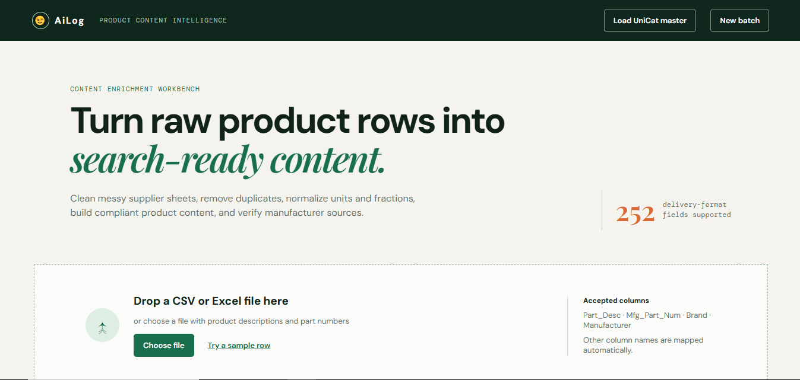

## How to Run

### Requirements
- Windows
- Python 3.x

### 1. Create a Virtual Environment

```
python -m venv .venv
.venv\Scripts\Activate.ps1
python -m pip install --upgrade pip
pip install -r requirements.txt

python server.py
```
# Unilog Content Enrichment Workbench

Run `python server.py`, open `http://127.0.0.1:8000`, upload a CSV/XLSX sheet, and click **Download enriched CSV**.

Implemented DOCX workflow: clean placeholder values → merge exact duplicates → normalize approved-style units and decimal inches → classify supported products → extract source-evidenced attributes → build content fields → official-domain source validation → full delivery-format CSV export.

The app does not invent product specifications. Unrecognised categories, brands, and manufacturer domains are flagged for review instead of producing a potentially inaccurate value.

The Python brand master also resolves common manufacturer/brand relationships from the product description. For example, `Freud Inc (2435)` is cleaned to `Freud Inc.`, Diablo records resolve to the Diablo brand, and raw `3M ... Cubitron II` descriptions resolve to `3M Company` / `3M` / `Cubitron II`.

## Want to Search Product By it's Product name or desc

`use ctrl + f`

## Code map

- `index.html` contains only the page structure and user-facing controls.
- `styles.css` contains the visual design, organized by page section.
- `server.py` owns the Python enrichment pipeline: alias detection, cleaning, de-duplication, unit normalization, classification, attributes, source links, and output data.
- `python-client.js` sends uploaded rows to the Python API and downloads the returned delivery CSV.
- `app.js` provides client-side CSV/XLSX parsing and the display interface.
- `tests/enrichment.test.js` contains small executable checks for schema and unit handling.

## Safe enrichment rule

Only data found in the uploaded row is written as a product attribute. The app leaves unavailable manufacturer data blank and adds a review reason instead of guessing. Official manufacturer searches go to an allowed manufacturer domain. Unknown brands use a separate reference search that excludes common ecommerce sites.

## Data define on web app
- Product name
- description
- links
- Message human review needs
- some links works
- link with 80% confinance mostly workalbe 

## Download the .CSV file
 click on download .csv and keep it save for next part. To find official links for the information
 use this link [Data_Enrichment](https://github.com/chirag-projects/Data_Enrichment)



